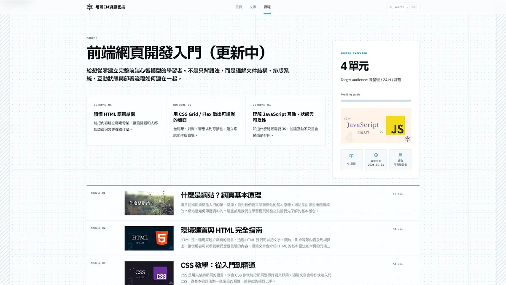

I’ve been fascinated by computers for as long as I can remember. Teaching myself technology helped me develop a wide range of skills and experience, but I kept running into the same problem: many useful tools and software had little or no documentation in Chinese.

So I started my own blog, 毛哥EM資訊密技, to explain how these tools work in a way that’s easy to understand, even for people with little programming experience.

And somehow, I kept writing for over five years.

The blog now covers everything from technology to art, including software and hardware tutorials, tools I’ve built, and things I’ve learned along the way. Altogether, I’ve written over 400,000 characters of original content.

What keeps me going is knowing that something I’ve written might help someone who’s struggling with a technical problem all alone.

The blog has received tens of thousands of views per month, and its advertising revenue is now enough to cover the server and domain costs of all my open-source projects, making them financially self-sustaining.

In 2023, my iThome Ironman series, _No Libraries, Still Cool: Playing with CSS & JavaScript Effects_, led to an invitation from a publisher to write a book. In 2024, I received an Honorable Mention in the DevOps category of the iThome Ironman competition.

## Four Generations of Architecture

While I kept writing articles, the website itself kept evolving.

The first version was built with Google Blogger during the pandemic, back when I was in middle school. I picked a template, changed a few colors, and even used iframes to squeeze in some of the design elements I wanted.

The second version used Hugo. It was stable and fast, and served me well until the summer after my first year of high school. But I wanted my own visual design and smoother page transitions. The theme I was using also had some Chinese character encoding issues that affected its sitemap and search functionality. Fixing everything would have meant tearing apart most of the theme’s core.

So I had a brilliant, incredibly naive thought:

_It’s just a blog generator, right? Convert Markdown to HTML, throw it into a template, and you’re done._

And that’s how the third version, **emblog**, was born.

Built with Node.js, emblog used almost no external libraries apart from `markdown-it` and `highlight.js`, two things I figured I probably couldn’t build better myself. Everything else, from the UI to the SPA functionality, was handcrafted.

It took about a year from concept to completion, with roughly a month of actual development.

It had all sorts of little details I loved. Custom transitions between articles. Parallax effects when returning to the homepage. And when you finished reading an article, you could keep scrolling, almost like Instagram Reels, as the next article expanded into view.

There was also the matter of my old thumbnails. Middle-school me apparently loved memes and made every thumbnail square. Displaying them in modern cards meant either cropping the images or leaving awkward empty spaces.

So I made emblog analyze the dominant colors of each image during the build process and automatically generate a matching gradient background.

These animations and visual effects eventually became part of my talk in the final main-stage session at SITCON 2025.

## 2026: Moving to Astro

After using emblog for a year and a half, I realized I’d essentially built my own SPA framework.

Everything was tightly interconnected, which made it difficult to extend. The entire system was designed around individual articles, with no proper support for courses or series that needed sequential reading and progress tracking.

(Also, I was getting a little tired of the design.)

For the fourth version, I switched to Astro.

I moved away from the romantic idea of building absolutely everything myself and toward a more practical philosophy: let mature tools handle what they already do well, and spend my time on content, learning experiences, the comment system, and long-term maintainability.

I still kept the architecture lightweight. The blog’s main dependencies are Astro, its search solution, and Lucide icons.

For search, I switched to Pagefind. Building full-text search for a static website from scratch would mean making visitors download a huge chunk of search data upfront. Pagefind handles indexing ahead of time.

Now you can press `/` or `Ctrl/⌘ + K` to search through the full text of articles and courses.

The biggest reason for the redesign, however, was the **course system**.

Each course has its own chapter order, learning outcomes, and estimated reading time for each lesson. Readers can move from one chapter to the next, following a structured path instead of jumping between unrelated posts.

Once you reach the bottom of a chapter, the website records your progress locally in your browser and marks the chapter as completed in the sidebar.

No account required.

The comment system was another major project. I decided against third-party services like giscus because of their loading performance and the need to authorize an external service to comment on the reader’s behalf.

Instead, I built my own comment backend on Cloudflare Workers, with data stored in Cloudflare D1.

It supports anonymous comments, GitHub login, threaded replies, Turnstile bot protection, rate limiting, spam detection, administrator moderation, and Discord notifications.

The website itself remains static, while the comments are fully dynamic.

Each comment also displays device, browser, and region information. It’s useful for spotting spam, and occasionally for starting a good old-fashioned operating system holy war.

For the visual design, I wanted something clean but full of personality. Inspired by the new Tailwind CSS website, I ended up with a mix of industrial minimalism, rough sketches, and engineering blueprints.

AI tools struggled to interpret the more complex layouts and animations, whether I showed them screenshots or tried explaining what I wanted. So I went back to designing in Figma and refining the details by hand.

I thought AI was supposed to replace web developers by now.

Apparently, frontend development isn’t quite dead yet.

If you’ve ever found yourself stuck on a problem, working alone late into the night, I hope there’s an article here that helps you find your way forward.
