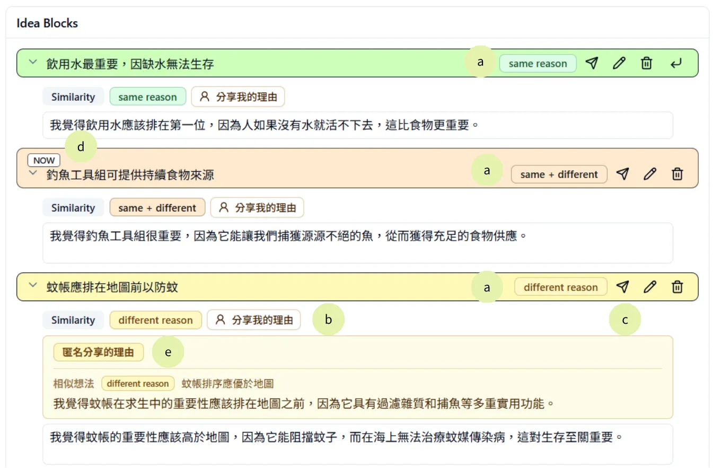

You have an idea, but you’re not sure anyone else will agree. You worry that someone with more expertise might find it ridiculous. You wait for the right moment to join in; by the time it comes, the conversation has moved on.

We didn’t invent this situation. Research participants described it themselves. One had ideas but couldn’t find a way into an animated discussion. Another tried to open a cue, only for it to disappear too quickly; the next time they opened one, the topic had already passed.

OmniObserve: Revealing Hidden Consensus in Online Meetings is a collaborative research project at National Yang Ming Chiao Tung University that explores this gap.

## A Fourth Moment

Online meetings that seek diverse perspectives often hit a bottleneck between private reflection and public contribution. When people expect to be judged, or don’t know whether anyone shares their reasoning, minority opinions and tentative ideas can remain unspoken.

Existing systems tend to organize public ideas, visibly intervene in discussions, or let AI privately evaluate an idea before it is shared. OmniObserve focuses on another moment: you have a private idea, someone else may hold a compatible one, and you are deciding whether to speak.

We use “hidden consensus” to describe overlap among participants’ private, unshared thoughts. “Pre-public social evidence” is a lightweight signal that such overlap may exist, before anyone decides to contribute.

## How the System Works

Participants’ private speech or typed input is transcribed and summarized into idea blocks: short, editable cards visible only to their author.

A global agent matches blocks across participants in three stages. First, it considers only other participants’ cards about the same task item. Second, it filters candidates using a cosine-similarity threshold of 0.7. Finally, an LLM classifier checks whether the ranking stance or practical recommendation is compatible.

Accepted matches become anonymous cues with three possible relationships: the same reason, a different reason, or both. Recipients can inspect the relationship, dismiss the cue, share a cue-scoped reason with the anonymous counterpart, send their own card to public chat, or do nothing. The counterpart’s complete private content is not revealed through these cues.

## Two Formative Studies

Study A was a between-subjects pilot using the Lost at Sea consensus task: one stranger group worked without cues, while another had cues enabled. Study B used a within-subject design, with each group completing one task with similarity cues and another without. The tasks were Lost at Sea, a reasoning exercise, and Enhance the Poster, a visual-design exercise. Each session included three real participants and one confederate who introduced a plausible public stance.

Higher ratings clustered around control over public release, the private-then-public flow supporting participation, and cue-related recognition and willingness to share.

## What We Observed

In stranger groups, participants described cues as private checks before speaking publicly. P04 said: “It felt like I could secretly check whether anyone had the same thought. If yes, then at least one or two people would agree, and I would not be completely rejected.” Knowing they might not face complete rejection could help them decide whether to speak. P11 also described feeling more confident and willing to express an idea after seeing a same-reason cue.

Silence is often strategic. Some participants waited for someone else to introduce a topic before adding their reasoning. Others had ideas all along but were waiting for a safe moment. Counting contributions alone can mistake that silence for disengagement.

Different people read the same cue differently. “Same reason” could mean safety, or redundancy and no need to speak again. “Different reason” could suggest disagreement risk, or an invitation to contribute another perspective. One participant noted that color markers might help less proactive people share matching ideas, while also making unmatched ideas harder to voice.

Familiarity changed the value of the components. Idea blocks were useful in both stranger and acquainted groups. Similarity cues were less influential among acquaintances; among strangers, they could offer support but also encourage caution.

Participants wanted lightweight cue-type markers before opening details, cues that remained available long enough to act on, and manual control over public release. P09 put it directly: “I would want to control it myself. If the system put my idea in public and said it was mine, that already feels forced.”

The central lesson was staged release control: clearly define what AI detects, when it appears, who receives it, and who can make it public. The aim is not to make AI better at talking, but to give people more opportunities to speak for themselves.

## My Role

OmniObserve is a team research project, with authors Shih-Kai Hong, Ethel Yu-Tsen Hsiao, Yi-Jie Chen, Jason Zhi-Jun Chang, Elvis Dragon Mao, and Grace Yu-Chun Yen. I participated throughout the research process, including literature gathering, research discussions, serving as a confederate, and supporting study sessions on site. The project was accepted as Poster 124 at TAICHI 2026 and received an Honorable Mention in NYCU’s Department of Computer Science project competition for academic year 115. The research is ongoing. Next steps include an open ideation task, transcript-linked analysis of how participants take up cues, and larger comparative studies.

We often expect technology to help people exchange information faster and finish discussions more efficiently. Sometimes, though, the obstacle is not a slow tool, but someone’s uncertainty about whether their voice will be accepted. OmniObserve has not answered every question. It gives us a chance to reconsider what good interaction design can offer: not only an easier way to speak, but a sense of safety and the freedom to decide when.

## References

Research details and participant quotations are adapted from [Sky Hong’s OmniObserve research introduction](https://skyhong.tw/omniobserve/), published under [CC BY-SA 4.0](https://creativecommons.org/licenses/by-sa/4.0/).
