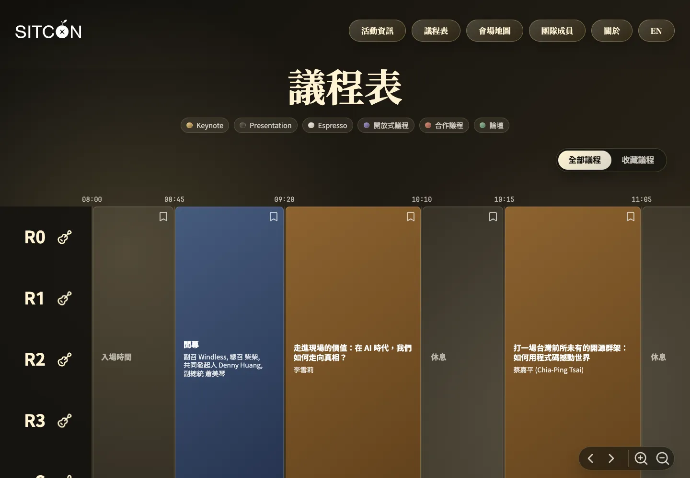
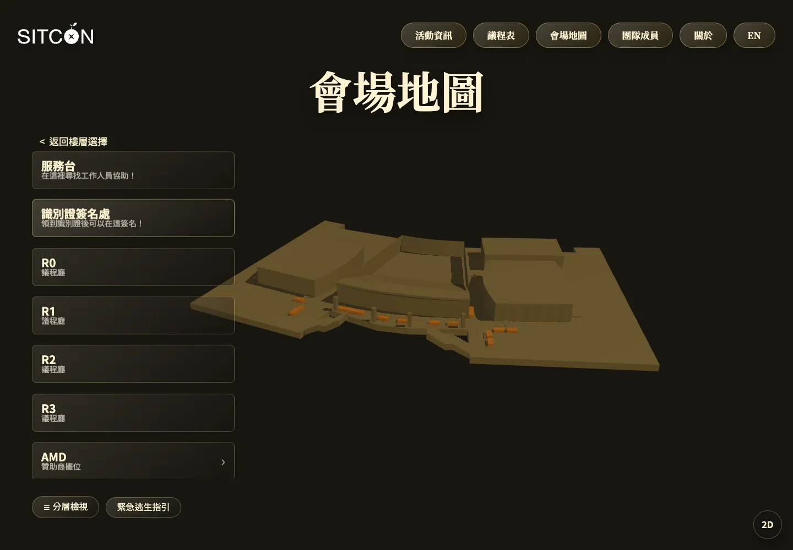

SITCON (Students’ Information Technology Conference) has been organized entirely by students from across Taiwan since 2012, bringing together over a thousand attendees each year.

The theme for 2026 was **Jam the Chaos**, drawing on the spirit of improvisational music to explore new ways for tech enthusiasts to interact with AI, peers, and collaborators across different disciplines.

The conference took place on March 28, 2026, at the Humanities and Social Sciences Building of Academia Sinica.

This year, I served as the development lead and also participated in the design team. I was responsible for much of the development while leading the team, and I designed most of the website.

We experimented with a lot of ambitious ideas and brought together all sorts of creative suggestions from the team.

We wanted visitors to feel the conference’s freedom, experimentation, and creativity while exploring its information, rather than simply reading through another event website.

## Enter the Chaos: Vortices and Slide to Unlock

The first thing you see is a 3D spiral vortex.

It rotates as you scroll and responds smoothly to mouse movements.

The chaos begins here.

The registration button recreates the classic “slide to unlock” interaction from early iPhones. Slide it across, and you’re taken to the registration system we developed ourselves.

As you scroll further, different sections move at different speeds, creating layers of parallax. Hovering over an invited speaker’s name reveals a floating portrait. Behind the ticket section, a marquee scrolls continuously, while the ticket types are designed to resemble physical tickets that expand when clicked.

## The Schedule: A Multitrack Composition

Most conference schedules are laid out vertically, from top to bottom.

This year, we designed ours to look like a digital audio workstation, scrolling horizontally instead.

Much like arranging tracks in music production software, sessions in different rooms appear side by side along a timeline, with time flowing from left to right.

It fits the _Jam_ theme, but there’s also a practical benefit: the horizontal layout allows more information to be viewed and compared at once.

You can bookmark your favorite sessions and copy a link to share your personalized schedule with friends.

And when you click “Share My Schedule,” the speakers you’re planning to see literally fall from the top of the screen.

We also developed the **SITCON MCP Server**.

Connect it to ChatGPT or another AI tool, tell it which topics interest you and when you’re busy, and it can help build your personalized schedule. It can even suggest what to explore during the gaps between sessions.

Jamming with AI in an age of chaos.

## The Venue: Bringing Academia Sinica into Your Browser

We recreated the Humanities and Social Sciences Building as an interactive 3D model.

Visitors can explore the venue directly in their browsers: click a floor to see what’s there, or select a booth to view its name and description.

Instead of staring at a flat floor plan and trying to figure out where everything is, you can explore the building spatially.

You can even take control of SITCON’s mascot, Little Rock, and wander around Academia Sinica in this miniature 3D world.

## The Team: Fake 3D, Real Photoshop

The team page features more than just profile pictures. Each member also has a personal introduction.

Hover over someone’s photo, and the person and background move at different speeds, creating a 2.5D parallax effect that makes the subject appear to pop out of the image.

After experimenting with depth cameras and various algorithms, I eventually settled on the most primitive solution, considering both quality and performance.

Photoshop.

I took every team member’s photo and manually separated the person from the background. Then I removed the person from the original image and reconstructed the missing areas to create a clean background.

Every photo had to be processed twice.

Seriously, why did we have to make this website so ridiculously hard to build?

Besides the traditional list view, we also built an exploration mode. Every team member becomes a circular portrait scattered across a giant navigable canvas, where you can move around and discover people you’d like to meet.

The website was built with Astro, using Three.js for 3D scenes, Cannon.js for physics, and GSAP for scrolling interactions and animations. And, of course, the Chinese fonts are loaded through emfont.

The source code is publicly available on GitHub, and the website was featured on Awwwards.

For me, the most rewarding part wasn’t how many technologies we used. It was working with a group of equally passionate people to turn all those “this would be so cool, but such a pain to build” ideas into reality.

**Jam the Chaos wasn’t just the conference theme. It was how we built the website.**
