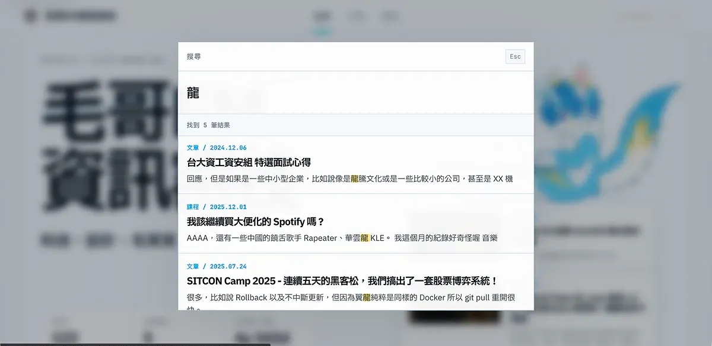
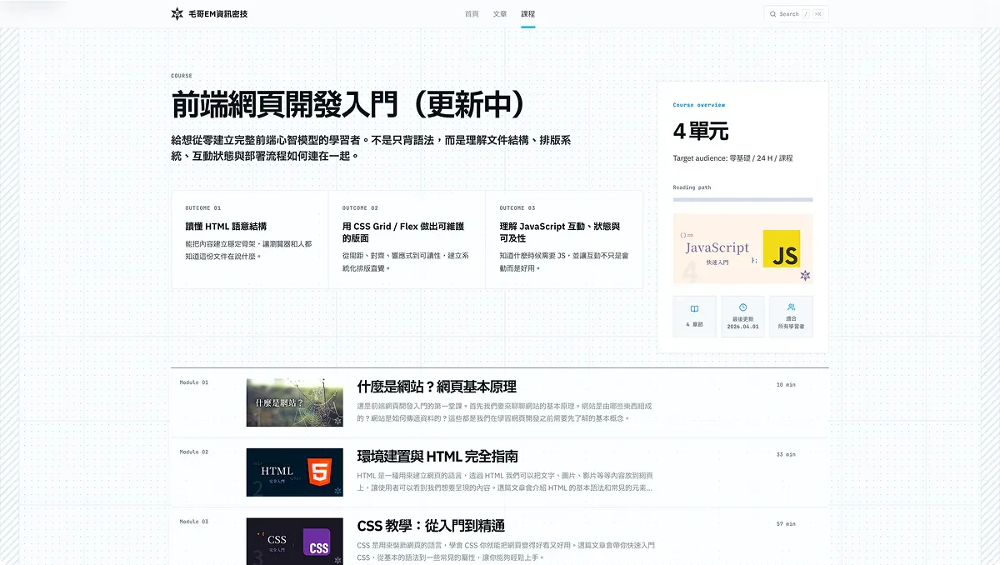

从小对于信息的热爱，让我在自学中累积了丰富的技能与创作经验。由于发现许多软件和工具缺乏中文资源，我决定创办个人博客，以浅显易懂的方式分享如何使用这些工具。即使是对程序设计不熟悉的人也能轻松上手。

一写就是五年多。这里有从科技到艺术的软硬件教学、自制工具和经验分享等原创文章，累积超过 40 万字。

每当能够帮助到一位独自在技术困境中挣扎的朋友，便是我持续维护这个平台的最大动力。每月皆有数万次浏览，现有的广告收益足以支持我所有开源项目的服务器和网域费用，实现了自主运营。同时，在 2023 年因参与 2023 iThome 铁人赛，撰写教学系列文《不用库 也能酷 - 玩转 CSS & Js 特效》，受出版社邀请撰写出版书籍。2024 iThome 铁人赛荣获 DevOps 组佳作。

## 四代架构

写文章的同时，这个网站本身也一直在重构。

第一版是国中疫情期间用 Google Blogger 做的，套个模板、改改颜色，为了塞进想要的设计还用了 iframe。第二版改用 Hugo，稳定又快，一路用到高一暑假。但我想要自己的设计和流畅的转场，套用的主题在中文编码上也有些问题，影响了 Sitemap 和搜索。真的要改，等于把主题核心整个拆掉。

于是我天真地想：博客生成器嘛，不就是把 Markdown 转成 HTML、塞进模板而已？

第三版 emblog 就这样诞生了。它用 Node.js 写成，除了 markdown-it 和 highlight.js 这两个不太可能做好的函数库以外，UI 和 SPA 全部自己手刻。从构思到完成大约一年，实际开发一个月左右。它有很多我很喜欢的小细节：文章之间有自己设计的转场，回到首页时有滚动视差；读完一篇可以像 reels 一样继续往下滑，下一篇会接着放大出现。国中的我做的缩图不只一堆梗图，还全是 1:1，放进卡片不是被切掉就是留白得很尴尬，所以 emblog 会在生成时分析每张图的主色，自动补上一层渐变背景。这些动画和特效，后来也在 SITCON 2025 主会场的最后一场议程发表。

## 2026：前往 Astro

emblog 用了一年半，我发现自己其实写出了一个 SPA 框架。各部分串得很精细，也因此很难扩充。它只为单篇文章设计，没办法支持课程或系列文这种要照顺序读、看得到进度的内容。（另外设计我也有点看腻了。）

第四版改用 Astro，从「什么都想自己做」的浪漫，转向比较务实的选择：成熟工具做得好的事交出去，时间留给内容体验、课程架构、留言系统和长期维护。不过架构依然维持轻量，整个博客实际用到的套件只有 Astro、搜索和 Lucide 图标。

搜索改用 Pagefind。静态网站要做全文搜索，自己写就得让读者先下载一大包数据；Pagefind 会先替内文建好索引。现在按 `/` 或 `Ctrl/⌘ + K`，就能搜索文章和课程内文。

这次改版最主要的目的是课程系统。每个课程有自己的章节顺序、学习成果和每章阅读时间，可以上一章、下一章一路读下去。读到章节底部，网站会在你的浏览器里记下这章已读完，侧边栏出现完成标记，不需要注册账号。

留言系统是另一个大工程。我没有用 giscus 这类第三方服务，因为它加载慢，而且等于要授权第三方服务以读者的身份留言。我自己写了一个跑在 Cloudflare Workers 上的留言后端，数据存在 Cloudflare D1。读者可以匿名留言、用 GitHub 登录、嵌套回复；后端有 Turnstile 防机器人、速率限制、spam 判断、管理员审核和 Discord 通知。网站本身仍是静态的，留言却是完整的动态功能。每则留言会标上设备、浏览器和地区，除了方便抓 spam，也顺便提供一点操作系统之间的宗教战争素材。

设计上，我想要干净但有个性。灵感来自 Tailwind CSS 的新官网，最后做成有点工业风、极简，又带点草稿和蓝图感的样子。复杂的画面和特效 AI 看图看不懂、讲也听不懂，还是回到 Figma 自己画，细节还是得手工慢慢雕。说好网页工程师要被 AI 取代，看来前端暂时还死不透。

如果你也曾经一个人卡在某个问题里，希望这里刚好有一篇能帮上你。
