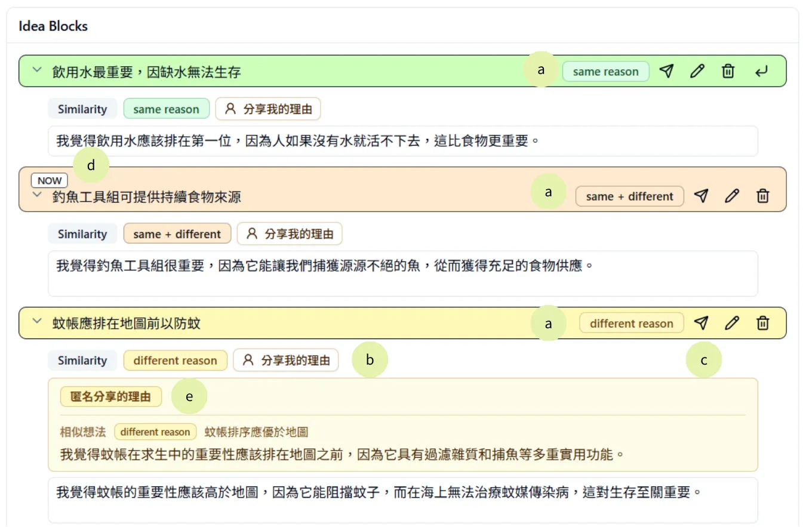

你有一个想法，但不肯定其他人会不会同意，也担心在场会不会有专业的人听到觉得很可笑。你在等一个适合插话的时机；等到了，话题已经换了。

这不是我们想象出来的情境，而是研究参与者自己描述的经验。有人说自己其实有想法，只是大家讨论得太热烈，不知道什么时候该加入；也有人说，第一次想点开提示时它消失得太快，第二次点开时话题已经过去了。

OmniObserve: Revealing Hidden Consensus in Online Meetings 是我在阳明交大的协作研究，想处理的就是这段缺口。

## 第四个时刻

在追求多元观点的在线会议里，从私下思考到公开发言之间常常卡着一道关卡。当人预期自己会被评价，或不知道别人是否也有类似的想法时，少数意见和还不成熟的点子就容易被留在心里。

现有的系统大多在帮忙整理公开的想法、在讨论中明显介入，或在分享前让 AI 私下评估。OmniObserve 瞄准的是另一个时刻：你有一个私下的想法，另一位参与者可能也有兼容的想法，而你正在决定要不要开口。

我们用「隐藏共识」（hidden consensus）指参与者之间尚未说出口、但彼此重叠的想法；用「公开前的社会证据」（pre-public social evidence）指在任何人决定发言之前，提示「这种重叠可能存在」的轻量信号。

## 系统怎么运作

参与者私下说出或打出的想法，会被转写、摘要成 idea block：简短、可编辑、只有本人看得到的卡片。

系统中的全局 agent 负责跨参与者配对，分三关筛选。第一关只比对同一个任务项目上其他人的卡片。第二关用语义相似度过滤，余弦相似度门槛为 0.7。第三关把剩下的交给 LLM 分类器，必须在排序立场或实际建议上兼容才算配对成功。

通过的配对会以匿名提示送出，分成三种：理由相同、理由不同，以及两者兼具。收到提示的人可以查看配对关系、关掉提示、只针对这则提示和匿名对象分享理由、把自己的卡片送到公开聊天室，或者什么都不做。无论选哪一个，对方完整的私人内容都不会公开。

## 两个形成性研究

Study A 是受试者间的先导研究，使用 Lost at Sea 共识任务：两组陌生人中，一组没有提示，一组打开提示。Study B 是受试者内设计，每组在一个任务中使用相似度提示、另一个任务中不使用，任务包括推理型的 Lost at Sea 和视觉设计型的 Enhance the Poster。每一场都有三位真正的参与者，以及一位暗桩，负责在讨论中提出一个看起来合理的公开立场。

评分较高的项目集中在三件事：能自己控制何时公开、先私下再公开的流程有助于参与，以及提示带来的认同感与分享意愿。

## 我们观察到的事

在陌生人组成的小组里，参与者把提示当成公开前的私下确认。P04 说：「It felt like I could secretly check whether anyone had the same thought. If yes, then at least one or two people would agree, and I would not be completely rejected.」先偷偷看看有没有人想法一样，知道至少不会完全被否定，再决定要不要说。P11 也说，看到 same-reason 提示时，觉得自己的想法是对的，更愿意表达。

沉默常常是一种策略。有人会等别人先提起，再补上自己的理由；有人想法一直都在，只是在等安全的时机。只看发言次数，很容易把这种沉默误读成不投入。

同一种提示，不同人读出不同意思。「理由相同」可能代表安全，也可能代表重复、不必再说；「理由不同」可能是意见冲突的风险，也可能是补充观点的邀请。有参与者提醒，颜色标记能帮不主动的人说出与他人相符的想法，却也可能让没配对到的想法更难说出口。

熟悉程度会改变组件的价值。idea block 在陌生组和熟人组都有用；相似度提示在熟人组里作用不明显，在陌生人之间多半带来支持，有时也让人更谨慎。

界面上，参与者希望先看到轻量的类型标记再决定要不要点开，提示要停留得够久，而且公开与否必须由自己决定。P09 说得很直接：「I would want to control it myself. If the system put my idea in public and said it was mine, that already feels forced.」

研究最核心的收获是「分阶段的公开控制」：设计时要明确定义 AI 侦测什么、什么时候出现、谁会收到，以及谁能把它公开。这个研究想做的，不是让 AI 更会说话，而是让人更有机会把话说出来。

## 我的角色

OmniObserve 是团队研究，作者依序为 Shih-Kai Hong、Ethel Yu-Tsen Hsiao、Yi-Jie Chen、Jason Zhi-Jun Chang、Elvis Dragon Mao 与 Grace Yu-Chun Yen。我参与了整个研究过程，包括搜集文献、参与讨论，以及在实验中担任暗桩与现场支持。研究以 Poster 124 入选 TAICHI 2026，并获得阳明交大资工系 115 学年度专题竞赛佳作。研究目前仍在进行，下一步计划加入开放式发想任务、对照会议逐字稿分析提示如何被接续使用，并进行规模更大的比较研究。

我们经常期待科技让人们更快速地交换信息、更有效率地完成讨论。但有时候，真正阻碍沟通的不是工具不够快，而是一个人不太确定自己的声音会不会被接纳。OmniObserve 还没有回答所有问题，但它让我们有机会重新思考：好的交互设计，或许不只是让人更容易说话，也包括让人有安全感，并且能自己决定什么时候开口。

## 参考资料

本文研究内容与参与者引文改写自 Sky Hong 撰写的 OmniObserve 研究介绍（[https://skyhong.tw/omniobserve/](https://skyhong.tw/omniobserve/)），原文以 [CC BY-SA 4.0](https://creativecommons.org/licenses/by-sa/4.0/) 授权。
