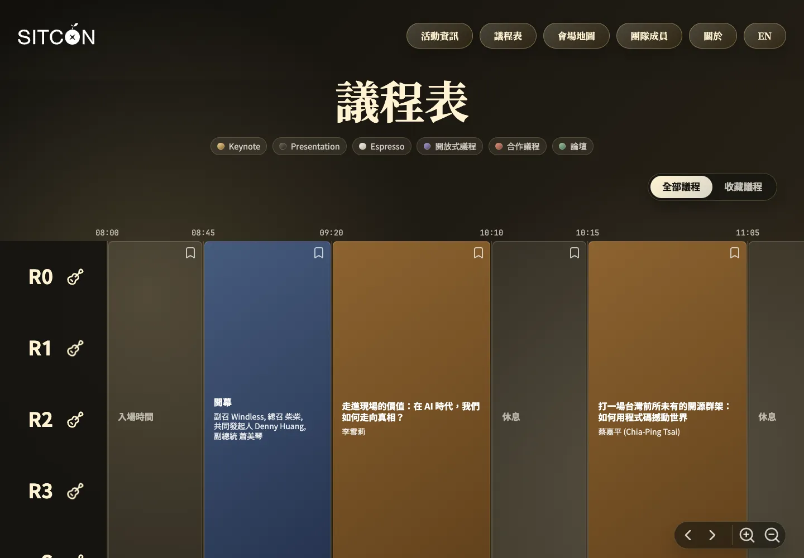
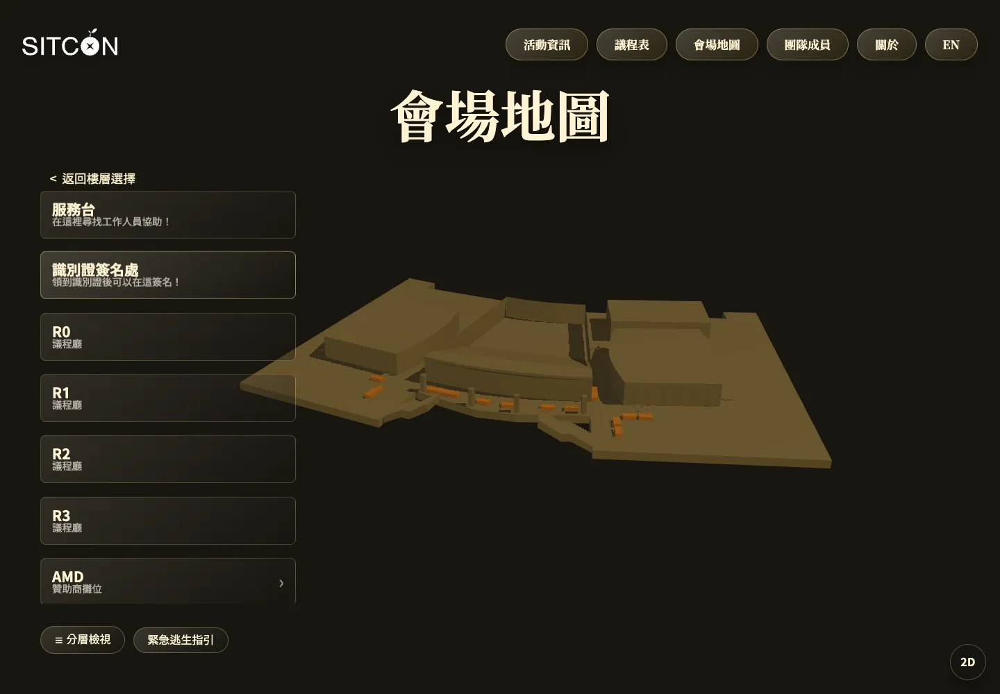

SITCON 学生计算机年会从 2012 年开始，由全台各地的学生自主筹办，每年吸引上千位会众。2026 年的主题是 Jam the Chaos，用即兴合奏的意象，描绘信息人才与 AI、同侪和跨域伙伴之间的新交互。活动于 3 月 28 日在中研院人文社会科学馆举行。

这次我担任开发组长，也参与设计组。大部分开发由我负责并带领团队完成，网站主要由我设计。我们在网站里做了很多大胆的尝试，也收进了团队里大家各式各样的点子。希望使用者在获取活动信息的同时，也能感受到这场年会自由、实验性与充满创意的氛围。

## 进场：漩涡与滑动解锁

首屏是一个 3D 螺旋漩涡，往下滚动时跟着旋转，鼠标移动时也会平滑地带动它。混乱从这里开始。

「我要报名」做成早期 iPhone 的滑动解锁，滑过去就跳到我们自己开发的报名系统。往下滚动，各区块有不同速度的视差；鼠标移到邀请讲者的名字上，就会浮出他们的头像。索票区背后跑着跑马灯，前方是一张张画成实体票券的票种，点一下就展开说明。

## 议程表：一首多轨的曲子

大部分年会的议程表从上往下排，这次我们把它做成编曲软件的样子，从左往右滚动。像编曲软件一样，同一时段各厅的议程并排展开，时间往右流动。这很贴合 Jam 的主题，横向排列一次能看见的信息也比较多。

收藏喜欢的议程后，可以复制链接，把自己的议程时间轴分享给朋友。按下「分享我的议程」，你想听的那些讲者头像还会从画面上方掉下来。

我们也做了 SITCON MCP server。用 ChatGPT 等 AI 工具连上它，告诉它你对哪些主题有兴趣、什么时间有别的事，它就能帮你排一份专属议程，还能建议中间的空档可以做什么。在混乱的时代与 AI 一起合奏。

## 会场：把中研院搬进浏览器

我们把整个人文社会科学馆的会场建成 3D 模型，网页上可以直接看立体地图：点一个楼层，看那一层有什么；点一个摊位，看它是什么摊位和它的简介。不必对着一张平面图研究半天，便能更直觉地理解会场。甚至可以操作 SITCON 的吉祥物小石，在这个 3D 世界里逛中研院。

## 团队：伪 3D 效果

团队页不只放大头照，也放了每个人写的自我介绍。鼠标移到成员身上时，人物和背景会以不同速度偏移，做出 2.5D 伪立体效果，让人从照片里浮出来。

使用深度镜头与各种算法之后，基于质量与性能的综合考量，最后使用了最原生的方法。我把每个人的照片一张张拿进 Photoshop，先把人去背抠出来，再把人从原图拿掉，补成一张干净的纯背景，每张照片都得处理两次。没事干嘛弄这么难写的网页。

除了列表模式，还有探索模式：所有人的头像变成圆形，铺满一整张大地图，你可以在上面移动，找到想认识的成员。

网站用 Astro 打造，3D 场景交给 Three.js，物理效果用 Cannon.js，滚动与动画靠 GSAP。中文字体当然是透过 emfont 加载。源代码公开在 GitHub，网站入选了 Awwwards。对我来说，最珍贵的不是用了多少技术，而是和一群同样充满热情的人，把那些「这个应该很好玩，但做起来一定很麻烦」的想法，一个个变成现实。Jam the Chaos 不只是年会的主题，也是我们开发这个网站的方式。
