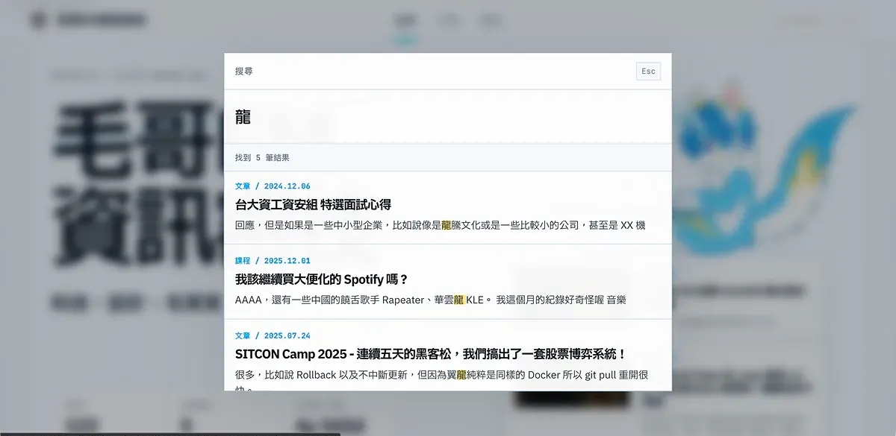
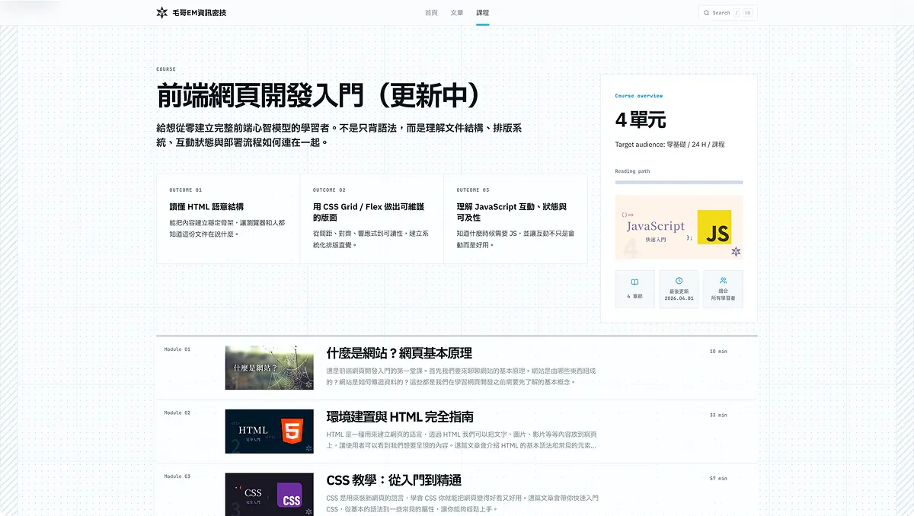

從小對於資訊的熱愛，讓我在自學中累積了豐富的技能與創作經驗。由於發現許多軟體和工具缺乏中文資源，我決定創辦個人部落格，以淺顯易懂的方式分享如何使用這些工具。即使是對程式設計不熟悉的人也能輕鬆上手。

一寫就是五年多。這裡有從科技到藝術的軟硬體教學、自製工具和經驗分享等原創文章，累積超過 40 萬字。

每當能夠幫助到一位獨自在技術困境中掙扎的朋友，便是我持續維護這個平台的最大動力。每月皆有數萬次瀏覽，現有的廣告收益足以支持我所有開源專案的伺服器和網域費用，實現了自主運營。同時，在 2023 年因參與 2023 iThome 鐵人賽，撰寫教學系列文《不用庫 也能酷 - 玩轉 CSS & Js 特效》，受出版社邀請撰寫出版書籍。2024 iThome 鐵人賽榮獲 DevOps 組佳作。

## 四代架構

寫文章的同時，這個網站本身也一直在重構。

第一版是國中疫情期間用 Google Blogger 做的，套個模板、改改顏色，為了塞進想要的設計還用了 iframe。第二版改用 Hugo，穩定又快，一路用到高一暑假。但我想要自己的設計和流暢的轉場，套用的主題在中文編碼上也有些問題，影響了 Sitemap 和搜尋。真的要改，等於把主題核心整個拆掉。

於是我天真地想：部落格生成器嘛，不就是把 Markdown 轉成 HTML、塞進模板而已？

第三版 emblog 就這樣誕生了。它用 Node.js 寫成，除了 markdown-it 和 highlight.js 這兩個不太可能做好的函式庫以外，UI 和 SPA 全部自己手刻。從構思到完成大約一年，實際開發一個月左右。它有很多我很喜歡的小細節：文章之間有自己設計的轉場，回到首頁時有滾動視差；讀完一篇可以像 reels 一樣繼續往下滑，下一篇會接著放大出現。國中的我做的縮圖不只一堆梗圖，還全是 1:1，放進卡片不是被切掉就是留白得很尷尬，所以 emblog 會在生成時分析每張圖的主色，自動補上一層漸層背景。這些動畫和特效，後來也在 SITCON 2025 主會場的最後一場議程發表。

## 2026：前往 Astro

emblog 用了一年半，我發現自己其實寫出了一個 SPA 框架。各部分串得很精細，也因此很難擴充。它只為單篇文章設計，沒辦法支援課程或系列文這種要照順序讀、看得到進度的內容。（另外設計我也有點看膩了。）

第四版改用 Astro，從「什麼都想自己做」的浪漫，轉向比較務實的選擇：成熟工具做得好的事交出去，時間留給內容體驗、課程架構、留言系統和長期維護。不過架構依然維持輕量，整個部落格實際用到的套件只有 Astro、搜尋和 Lucide 圖示。

搜尋改用 Pagefind。靜態網站要做全文搜尋，自己寫就得讓讀者先下載一大包資料；Pagefind 會先替內文建好索引。現在按 `/` 或 `Ctrl/⌘ + K`，就能搜尋文章和課程內文。

這次改版最主要的目的是課程系統。每個課程有自己的章節順序、學習成果和每章閱讀時間，可以上一章、下一章一路讀下去。讀到章節底部，網站會在你的瀏覽器裡記下這章已讀完，側邊欄出現完成標記，不需要註冊帳號。

留言系統是另一個大工程。我沒有用 giscus 這類第三方服務，因為它載入慢，而且等於要授權第三方服務以讀者的身分留言。我自己寫了一個跑在 Cloudflare Workers 上的留言後端，資料存在 Cloudflare D1。讀者可以匿名留言、用 GitHub 登入、巢狀回覆；後端有 Turnstile 防機器人、速率限制、spam 判斷、管理員審核和 Discord 通知。網站本身仍是靜態的，留言卻是完整的動態功能。每則留言會標上裝置、瀏覽器和地區，除了方便抓 spam，也順便提供一點作業系統之間的宗教戰爭素材。

設計上，我想要乾淨但有個性。靈感來自 Tailwind CSS 的新官網，最後做成有點工業風、極簡，又帶點草稿和藍圖感的樣子。複雜的畫面和特效 AI 看圖看不懂、講也聽不懂，還是回到 Figma 自己畫，細節還是得手工慢慢雕。說好網頁工程師要被 AI 取代，看來前端暫時還死不透。

如果你也曾經一個人卡在某個問題裡，希望這裡剛好有一篇能幫上你。
