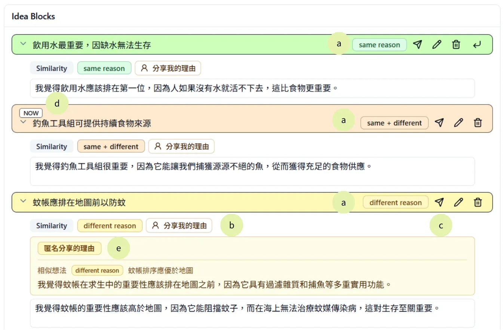

你有一個想法，但不確定其他人會不會同意，也擔心在場會不會有專業的人聽到覺得很可笑。你在等一個適合插話的時機；等到了，話題已經換了。

這不是我們想像出來的情境，而是研究參與者自己描述的經驗。有人說自己其實有想法，只是大家討論得太熱烈，不知道什麼時候該加入；也有人說，第一次想點開提示時它消失得太快，第二次點開時話題已經過去了。

OmniObserve: Revealing Hidden Consensus in Online Meetings 是我在陽明交大的協作研究，想處理的就是這段缺口。

## 第四個時刻

在追求多元觀點的線上會議裡，從私下思考到公開發言之間常常卡著一道關卡。當人預期自己會被評價，或不知道別人是否也有類似的想法時，少數意見和還不成熟的點子就容易被留在心裡。

現有的系統大多在幫忙整理公開的想法、在討論中明顯介入，或在分享前讓 AI 私下評估。OmniObserve 瞄準的是另一個時刻：你有一個私下的想法，另一位參與者可能也有相容的想法，而你正在決定要不要開口。

我們用「隱藏共識」（hidden consensus）指參與者之間尚未說出口、但彼此重疊的想法；用「公開前的社會證據」（pre-public social evidence）指在任何人決定發言之前，提示「這種重疊可能存在」的輕量訊號。

## 系統怎麼運作

參與者私下說出或打出的想法，會被轉寫、摘要成 idea block：簡短、可編輯、只有本人看得到的卡片。

系統中的全域 agent 負責跨參與者配對，分三關篩選。第一關只比對同一個任務項目上其他人的卡片。第二關用語意相似度過濾，餘弦相似度門檻為 0.7。第三關把剩下的交給 LLM 分類器，必須在排序立場或實際建議上相容才算配對成功。

通過的配對會以匿名提示送出，分成三種：理由相同、理由不同，以及兩者兼具。收到提示的人可以查看配對關係、關掉提示、只針對這則提示和匿名對象分享理由、把自己的卡片送到公開聊天室，或者什麼都不做。無論選哪一個，對方完整的私人內容都不會公開。

## 兩個形成性研究

Study A 是受試者間的先導研究，使用 Lost at Sea 共識任務：兩組陌生人中，一組沒有提示，一組開啟提示。Study B 是受試者內設計，每組在一個任務中使用相似度提示、另一個任務中不使用，任務包括推理型的 Lost at Sea 和視覺設計型的 Enhance the Poster。每一場都有三位真正的參與者，以及一位暗樁，負責在討論中提出一個看起來合理的公開立場。

評分較高的項目集中在三件事：能自己控制何時公開、先私下再公開的流程有助於參與，以及提示帶來的認同感與分享意願。

## 我們觀察到的事

在陌生人組成的小組裡，參與者把提示當成公開前的私下確認。P04 說：「It felt like I could secretly check whether anyone had the same thought. If yes, then at least one or two people would agree, and I would not be completely rejected.」先偷偷看看有沒有人想法一樣，知道至少不會完全被否定，再決定要不要說。P11 也說，看到 same-reason 提示時，覺得自己的想法是對的，更願意表達。

沉默常常是一種策略。有人會等別人先提起，再補上自己的理由；有人想法一直都在，只是在等安全的時機。只看發言次數，很容易把這種沉默誤讀成不投入。

同一種提示，不同人讀出不同意思。「理由相同」可能代表安全，也可能代表重複、不必再說；「理由不同」可能是意見衝突的風險，也可能是補充觀點的邀請。有參與者提醒，顏色標記能幫不主動的人說出與他人相符的想法，卻也可能讓沒配對到的想法更難說出口。

熟悉程度會改變元件的價值。idea block 在陌生組和熟人組都有用；相似度提示在熟人組裡作用不明顯，在陌生人之間多半帶來支持，有時也讓人更謹慎。

介面上，參與者希望先看到輕量的類型標記再決定要不要點開，提示要停留得夠久，而且公開與否必須由自己決定。P09 說得很直接：「I would want to control it myself. If the system put my idea in public and said it was mine, that already feels forced.」

研究最核心的收穫是「分階段的公開控制」：設計時要明確定義 AI 偵測什麼、什麼時候出現、誰會收到，以及誰能把它公開。這個研究想做的，不是讓 AI 更會說話，而是讓人更有機會把話說出來。

## 我的角色

OmniObserve 是團隊研究，作者依序為 Shih-Kai Hong、Ethel Yu-Tsen Hsiao、Yi-Jie Chen、Jason Zhi-Jun Chang、Elvis Dragon Mao 與 Grace Yu-Chun Yen。我參與了整個研究過程，包括蒐集文獻、參與討論，以及在實驗中擔任暗樁與現場支援。研究以 Poster 124 入選 TAICHI 2026，並獲得陽明交大資工系 115 學年度專題競賽佳作。研究目前仍在進行，下一步計畫加入開放式發想任務、對照會議逐字稿分析提示如何被接續使用，並進行規模更大的比較研究。

我們經常期待科技讓人們更快速地交換資訊、更有效率地完成討論。但有時候，真正阻礙溝通的不是工具不夠快，而是一個人不確定自己的聲音會不會被接納。OmniObserve 還沒有回答所有問題，但它讓我們有機會重新思考：好的互動設計，或許不只是讓人更容易說話，也包括讓人有安全感，並且能自己決定什麼時候開口。

## 參考資料

本文研究內容與參與者引文改寫自 Sky Hong 撰寫的 OmniObserve 研究介紹（[https://skyhong.tw/omniobserve/](https://skyhong.tw/omniobserve/)），原文以 [CC BY-SA 4.0](https://creativecommons.org/licenses/by-sa/4.0/) 授權。
