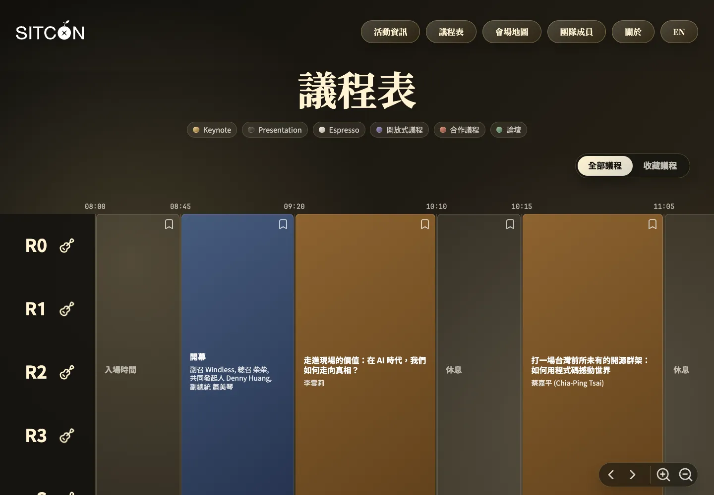
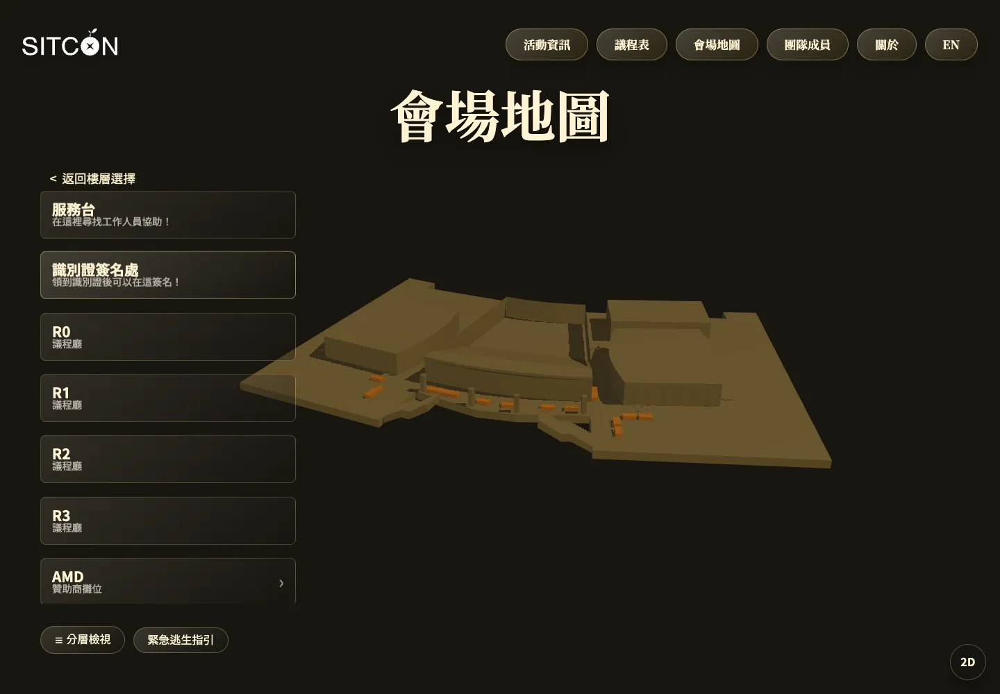

SITCON 學生計算機年會從 2012 年開始，由全臺各地的學生自主籌辦，每年吸引上千位會眾。2026 年的主題是 Jam the Chaos，用即興合奏的意象，描繪資訊人才與 AI、同儕和跨域夥伴之間的新互動。活動於 3 月 28 日在中研院人文社會科學館舉行。

這次我擔任開發組長，也參與設計組。大部分開發由我負責並帶領團隊完成，網站主要由我設計。我們在網站裡做了很多大膽的嘗試，也收進了團隊裡大家各式各樣的點子。希望使用者在獲取活動資訊的同時，也能感受到這場年會自由、實驗性與充滿創意的氛圍。

## 進場：漩渦與滑動解鎖

首屏是一個 3D 螺旋漩渦，往下捲動時跟著旋轉，滑鼠移動時也會平滑地帶動它。混亂從這裡開始。

「我要報名」做成早期 iPhone 的滑動解鎖，滑過去就跳到我們自己開發的報名系統。往下捲動，各區塊有不同速度的視差；滑鼠移到邀請講者的名字上，就會浮出他們的頭像。索票區背後跑著跑馬燈，前方是一張張畫成實體票券的票種，點一下就展開說明。

## 議程表：一首多軌的曲子

大部分年會的議程表從上往下排，這次我們把它做成編曲軟體的樣子，從左往右捲動。像編曲軟體一樣，同一時段各廳的議程並排展開，時間往右流動。這很貼合 Jam 的主題，橫向排列一次能看見的資訊也比較多。

收藏喜歡的議程後，可以複製連結，把自己的議程時間軸分享給朋友。按下「分享我的議程」，你想聽的那些講者頭像還會從畫面上方掉下來。

我們也做了 SITCON MCP server。用 ChatGPT 等 AI 工具連上它，告訴它你對哪些主題有興趣、什麼時間有別的事，它就能幫你排一份專屬議程，還能建議中間的空檔可以做什麼。在混亂的時代與 AI 一起合奏。

## 會場：把中研院搬進瀏覽器

我們把整個人文社會科學館的會場建成 3D 模型，網頁上可以直接看立體地圖：點一個樓層，看那一層有什麼；點一個攤位，看它是什麼攤位和它的簡介。不必對著一張平面圖研究半天，便能更直覺地理解會場。甚至可以操作 SITCON 的吉祥物小石，在這個 3D 世界裡逛中研院。

## 團隊：偽 3D 效果

團隊頁不只放大頭照，也放了每個人寫的自我介紹。滑鼠移到成員身上時，人物和背景會以不同速度偏移，做出 2.5D 偽立體效果，讓人從照片裡浮出來。

使用深度鏡頭與各種演算法之後，基於品質與性能的綜合考量，最後使用了最原生的方法。我把每個人的照片一張張拿進 Photoshop，先把人去背摳出來，再把人從原圖拿掉，補成一張乾淨的純背景，每張照片都得處理兩次。沒事幹嘛弄這麼難寫的網頁。

除了列表模式，還有探索模式：所有人的頭像變成圓形，鋪滿一整張大地圖，你可以在上面移動，找到想認識的成員。

網站用 Astro 打造，3D 場景交給 Three.js，物理效果用 Cannon.js，捲動與動畫靠 GSAP。中文字型當然是透過 emfont 載入。原始碼公開在 GitHub，網站入選了 Awwwards。對我來說，最珍貴的不是用了多少技術，而是和一群同樣充滿熱情的人，把那些「這個應該很好玩，但做起來一定很麻煩」的想法，一個個變成現實。Jam the Chaos 不只是年會的主題，也是我們開發這個網站的方式。
